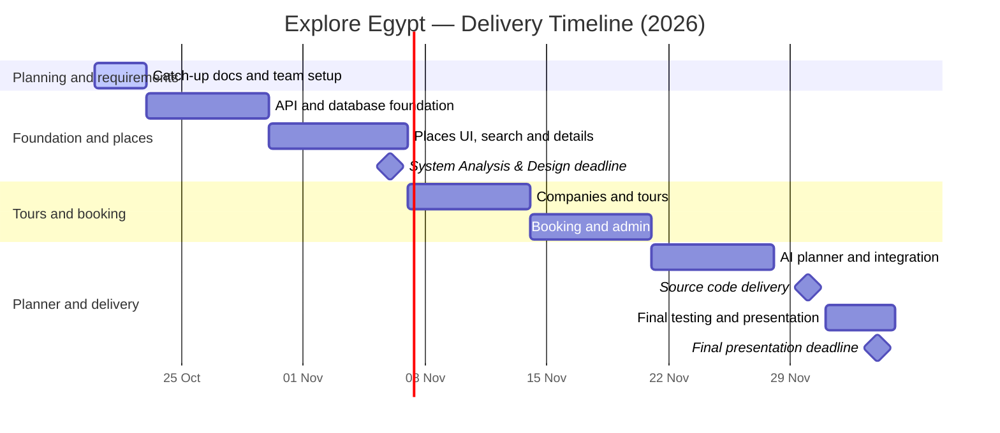

# Explore Egypt — Project Planning & Management

**Document version:** 1.0  
**Prepared:** 16 October 2026  
**Project type:** Graduation Project — Web Application  
**Team size:** 6 students  
**Status:** Planning draft for team review and GitHub submission

> **Team note:** Team responsibilities below are a practical proposal based on the current project scope. The team should confirm the assignments before treating them as final. The frontend framework is intentionally marked **TBD** because the team has not selected it yet.

## 1. Project Overview

### 1.1 Project name
**Explore Egypt — Discover Beyond the Famous Places**

### 1.2 Project summary
Explore Egypt is a tourism discovery and trip-planning platform focused on Egyptian destinations, including lesser-known places. Visitors can search and filter places, explore destination details, review nearby facilities and listed fees where available, discover tours offered by approved tourism companies, submit booking requests, save favorite places, and use an AI-assisted planner to draft an itinerary from the platform's available destination data.

### 1.3 Problem statement
Travelers may need to consult multiple sources to discover destinations, understand practical visit information, compare organized tours, and plan a coherent trip. Lesser-known destinations may also be harder to discover. Explore Egypt aims to bring destination information, tour discovery, and basic planning into one website.

### 1.4 Objectives
1. Provide one searchable catalogue of Egyptian tourism destinations.
2. Make destination information easier to explore through categories, governorates, images, fees, and nearby facilities when reliable data is available.
3. Allow approved tourism companies to publish tours and schedules.
4. Let registered users submit booking requests and track their statuses.
5. Provide an AI-assisted itinerary proposal grounded in destinations stored in the platform.
6. Deliver a maintainable web application with documented setup instructions and tested core flows.

## 2. Scope

### 2.1 In scope for the first release (MVP)
- Public home page and destination discovery pages.
- Search and basic filters by name, governorate, and category.
- Destination details: description, images, location, category, listed fees, and nearby facilities when verified data is available.
- Hierarchical categories, including religious, historical, natural, cultural, and recreational tourism.
- User registration/login and role-based access.
- Tourism company profiles with an admin approval status.
- Tours, tour stops, and scheduled departures with dates and capacity.
- Booking requests with status tracking; no online payment in the MVP.
- Basic admin tools for managing destinations, categories, companies, and published content.
- Favorites and place reviews, provided the core flows are stable.
- AI Travel Planner as a bounded feature: recommend an itinerary from places already in the platform database. Exact provider/model is TBD.
- Seed data for a selected, manageable set of Egyptian destinations and demo companies/tours.
- GitHub documentation, testing notes, and a final demo.

### 2.2 Out of scope for the first release
- Online payments, refunds, commissions, or payout processing.
- Real-time integration with external tour-company booking systems.
- A mobile application.
- Live chat between travelers and companies.
- Guaranteed availability or live prices from third parties.
- Complex route optimization, real-time traffic, or weather predictions.
- A production marketplace launch with legal/operational verification of real tour operators.

### 2.3 Assumptions and constraints
- The project is built by a team of six students with mixed experience and a limited delivery window.
- The backend direction is ASP.NET Core Web API with C# and SQL Server/Entity Framework Core, subject to team confirmation and available development environments.
- **Frontend framework: TBD.** Decide by 21 October 2026. Prefer the frontend option the team can build and integrate reliably within the deadline; do not choose Angular only for technology-name value if the team cannot deliver it in time.
- Demo company profiles and tours may be used for the academic demonstration and must be clearly treated as sample data.
- Fees, facilities, descriptions, and images should come from checked sources; unknown data should be left unavailable rather than invented.
- AI suggestions are recommendations, not guarantees of opening hours, costs, travel time, or service availability.

## 3. Proposed Solution and High-Level Architecture

### 3.1 Main system areas
- **Public website:** home, place discovery, place details, tours, tour details, and registration/login.
- **Traveler account:** bookings, favorites, saved itineraries, and reviews.
- **Company dashboard:** company profile, tour management, departure schedules, and booking requests.
- **Admin dashboard:** destination/category management, company approval, content moderation, and basic oversight.
- **Backend API:** authentication/authorization, destination data, tour management, booking workflow, and planner endpoints.
- **Database:** users/roles, governorates, categories, places, images, fees, facilities, companies, tours, tour stops, schedules, bookings, reviews, favorites, and itineraries/items as time allows.
- **AI planner:** retrieves candidate places from the application database and uses an LLM API to format suggestions. Provider and exact integration are TBD.

### 3.2 Proposed technology decisions
| Area | Proposed choice | Status |
|---|---|---|
| Backend | ASP.NET Core Web API, C# | Proposed; confirm as a team |
| Database | SQL Server + Entity Framework Core | Proposed; confirm local setup |
| API testing | Swagger/OpenAPI; manual tests and test cases | Proposed |
| Frontend | Angular **or** HTML/CSS/JavaScript | **TBD by 21 Oct 2026** |
| Version control | GitHub repository, Issues, Pull Requests, Projects | Required working approach |
| AI | External LLM API with database-grounded place selection | Provider TBD; implement after core flows |
| Packaging | Docker if time permits after local integration | Late-phase enhancement, not a blocker |

## 4. Deliverables

| ID | Deliverable | Acceptance evidence |
|---|---|---|
| D1 | Project proposal and scope | This document; agreed MVP and exclusions |
| D2 | Project plan, milestones, roles, risks, and KPIs | This document; team confirms owners and dates |
| D3 | Requirements specification | `02_Requirements_Gathering.md` |
| D4 | System analysis and design package | Use cases, ERD, architecture, and key workflows; target date 6 Nov 2026 |
| D5 | Working source code | Code in GitHub; target date 30 Nov 2026 |
| D6 | Database and API | Migrations/seed data and Swagger/OpenAPI documentation |
| D7 | Test records | Test cases, results, known issues, and fixes |
| D8 | Local setup and user/technical guides | README plus brief user instructions |
| D9 | Final presentation and demo | Demonstrable end-to-end flow; target date 4 Dec 2026 |

## 5. Work Plan and Timeline

The following catch-up schedule is aligned to the supplied project documentation calendar. The Planning and Requirements documents were due on 16 October 2026; this version is prepared on 20 October 2026 for catch-up submission. The supplied calendar lists System Analysis & Design for 6 November, Implementation for 30 November, and Final Presentation & Testing/Reports for 4 December 2026.

### 5.1 Timeline

| Phase | Dates | Main activities | Exit condition |
|---|---|---|---|
| P0 — Catch-up planning | 20–22 Oct | Submit planning and requirements docs; confirm frontend; create repo/Project board; assign owners | Docs committed, repository and board ready, roles confirmed |
| P1 — Foundation | 23–29 Oct | API skeleton, database context, entities, migrations, seed places, first places endpoints, initial frontend shell | A place list is retrieved from the API and shown in the UI or a working API demo is ready |
| P2 — Places and design checkpoint | 30 Oct–6 Nov | Place details, search/filters, categories/governorates, final ERD/use cases/architecture, initial test scenarios | Design package ready by 6 Nov; core places flow demonstrated |
| P3 — Companies and tours | 7–13 Nov | Company profile/status, tours, tour stops, departure schedules, company pages | Approved/demo company can manage a tour and schedule |
| P4 — Booking and admin | 14–20 Nov | Booking request flow, status changes, traveler bookings page, admin place/company management | Traveler submits a booking and company can accept/reject it |
| P5 — Planner and secondary features | 21–27 Nov | AI planner grounded in stored places; favorites/reviews if feasible; integration fixes | Planner demonstration or documented fallback; core flow remains stable |
| P6 — Stabilization | 28–30 Nov | Functional/integration tests, critical bug fixes, README, seed-data cleanup, optional Docker | Source code and execution package ready by 30 Nov |
| P7 — Final handoff | 1–4 Dec | User guide, technical docs, final test report, presentation/demo rehearsal | Final presentation package ready by 4 Dec |

### 5.2 Mermaid Gantt view



### 5.3 Milestones
- **M0 — Team Ready (22 Oct):** scope agreed, frontend decision recorded, repository/board created, six owners confirmed.
- **M1 — Places Vertical Slice (29 Oct):** database-backed place listing works end to end.
- **M2 — Design Checkpoint (6 Nov):** requirements, ERD, use cases, and architecture reviewed.
- **M3 — Tour Discovery (13 Nov):** companies, tours, tour stops, and schedules work with sample data.
- **M4 — Booking Workflow (20 Nov):** traveler booking request and company decision flow works.
- **M5 — Feature Freeze (27 Nov):** planner integrated if stable; no new major features after this date.
- **M6 — Source Code Ready (30 Nov):** critical defects resolved and setup documented.
- **M7 — Final Presentation (4 Dec):** demo and submission materials ready.

## 6. Team Roles and Resource Allocation

### 6.1 Proposed responsibility matrix

The names below are based on the team list previously supplied. The allocations are **proposed, not verified skill assessments**. Confirm the team leader, each person's actual strengths, and the final assignment before submission.

| # | Team member (English rendering) | Name as provided (Arabic) | Proposed primary ownership | Shared responsibility |
|---:|---|---|---|---|
| 1 | Ibrahim Mohamed Ibrahim Saleh | ابراهيم محمد ابراهيم صالح | Technical coordination; API foundation; integration and PR review | Define API conventions; unblock cross-module integration |
| 2 | Amr Mostafa Ali Ahmed | عمرو مصطفى علي احمد | Places, governorates, categories, place images, fees/facilities data model and API | Verify destination seed data; test places endpoints |
| 3 | Nour El-Din Ahmed Shabana | نور الدين احمد شبانه | Companies, tours, tour stops, and departure schedules | Review data relationships and tour API contracts |
| 4 | Iman Youssef Mohamed El-Gharbawy | إيمان يوسف محمد الغرباوي | Booking workflow, booking rules, and API test scenarios | Validate booking states and edge cases |
| 5 | Rawan Abdo Abdo Sheta | روان عبده عبده شتا | Public frontend: home, browse places, place details, tours discovery | Connect UI to API after the API contract is agreed |
| 6 | Julie Mohamed Ali Mohamed | جولي محمد علي محمد | Company/admin UI support, documentation, and integration test coordination | README, user instructions, and final test evidence |

**Team leader:** To be confirmed by the team. The table above is a proposed work split, not a confirmed statement of each member's skills or final assignment. Confirm names/transliterations, team-leader status, and responsibilities before submission.

**AI planner ownership:** treat this as a shared feature led by the technical coordinator and public-frontend owner after place APIs are stable. If time is short, release a deterministic itinerary recommendation based on category/region/duration before adding an external LLM API.

### 6.2 Allocation rules
- Every GitHub Issue has **one directly responsible owner**; helpers may be listed separately.
- Keep tasks small enough to finish or review in approximately 0.5–2 working days where possible.
- The owner opens a Pull Request and requests one reviewer who did not author the change.
- Reviewers test the behavior, not only formatting.
- Team members should pair across skill levels; role ownership does not mean working in isolation.
- Rebalance responsibilities weekly based on actual progress and blockers.

## 7. GitHub Workflow and Project Management

### 7.1 Repository structure

```text
explore-egypt/
├── backend/
│   └── ExploreEgypt.Api/
├── frontend/                  # chosen frontend project
├── docs/
│   ├── 01_Project_Planning_and_Management.md
│   ├── 02_Requirements_Gathering.md
│   ├── system-design.md       # add by 6 Nov
│   ├── database-erd.md        # add by 6 Nov
│   └── test-plan.md           # add during implementation
└── README.md
```

### 7.2 GitHub Projects board
Create a project named **Explore Egypt — Development Board** and use these status values:
- **Backlog** — accepted idea, not committed to the current iteration.
- **Todo** — ready to start and has clear acceptance criteria.
- **In Progress** — currently being implemented; limit parallel work.
- **Review** — Pull Request opened and awaiting review/test.
- **Blocked** — cannot progress because of a dependency or external decision.
- **Done** — acceptance criteria met, reviewed, and merged.

Recommended fields: **Status**, **Assignee**, **Priority** (High/Medium/Low), **Iteration** (Week 1…Week 7), **Milestone**, and **Area** (Backend/Frontend/Database/AI/Testing/Docs).

### 7.3 Labels
`backend`, `frontend`, `database`, `ai`, `testing`, `documentation`, `bug`, `blocked`, `priority:high`.

### 7.4 Milestones in GitHub
- `M1 — Foundation and Places` — through 29 Oct.
- `M2 — System Analysis & Design` — due 6 Nov.
- `M3 — Companies and Tours` — due 13 Nov.
- `M4 — Booking and Admin` — due 20 Nov.
- `M5 — AI Planner and Integration` — due 27 Nov.
- `M6 — Source Code Delivery` — due 30 Nov.
- `M7 — Final Presentation` — due 4 Dec.

### 7.5 Branch and Pull Request rules
- Branch naming: `feature/<issue-number>-short-name`, `fix/<issue-number>-short-name`, `docs/<issue-number>-short-name`.
- Do not commit directly to `main` except for an agreed initial repository setup.
- PR titles should reference the Issue; PR descriptions should include `Closes #<issue-number>` when appropriate.
- A PR must include a short summary, test steps, screenshots for UI changes, and any database migration note.
- Keep commits focused and descriptive.
- Never commit passwords, API keys, connection strings containing credentials, or real personal data. Use a safe sample configuration file.

### 7.6 Definition of Ready
An Issue is ready when it has: a clear title, purpose, owner, acceptance criteria, dependencies, relevant label, and milestone/iteration.

### 7.7 Definition of Done
An Issue is done when:
1. The acceptance criteria are met.
2. The code or document is committed in a branch and merged after review.
3. The relevant happy path and a meaningful failure case were tested.
4. Any API/schema changes are reflected in documentation.
5. The application still builds/runs, or the known limitation is documented.

## 8. Risk Assessment and Mitigation

| ID | Risk | Likelihood | Impact | Mitigation / contingency | Owner |
|---|---|---|---|---|---|
| R1 | Frontend choice delayed or too ambitious for current skill | Medium | High | Decide by 21 Oct; choose based on demonstrated ability; keep UI scope small | P1 + P5 |
| R2 | Team skill levels differ significantly | High | High | Small Issues, pairing, code reviews, quick demos, shared setup guide | All; coordinated by P1 |
| R3 | Backend/API contracts change and break frontend integration | Medium | High | Agree response DTOs/endpoints early; mock data while APIs are pending; integrate weekly | P1 + module owners |
| R4 | Scope creep from optional features | High | High | Protect core place→tour→booking flow; defer nonessential features after 27 Nov | All |
| R5 | Inaccurate place/fee/facility information or image licensing concerns | Medium | Medium | Record source and date for data; omit unverified values; use appropriate image permissions/attribution | P2 + P5 |
| R6 | AI returns made-up destinations, prices, or schedules | Medium | High | Retrieve candidates from database; do not let AI invent availability or fee values; show a clear AI disclaimer | P1 + AI owner |
| R7 | Booking oversells seats or has invalid state changes | Medium | High | Validate capacity at confirmation; enforce allowed status transitions; test competing/duplicate requests where feasible | P4 + P3 |
| R8 | Environment/setup differences block team members | Medium | High | Document versions and setup; add seed data and safe sample config; have each member run the project early | P1 + P6 |
| R9 | Demo or deployment fails near deadline | Medium | High | Prepare local demo and seeded backup data; freeze features on 27 Nov; rehearse before 4 Dec | P6 + all |
| R10 | External LLM API quota, access, or cost blocks AI feature | Medium | Medium | Keep provider optional; implement database-based itinerary baseline first; store secrets in local environment | AI owner |

## 9. Key Performance Indicators (KPIs)

These are proposed targets for an academic MVP and should be adjusted if the instructor provides different criteria.

| KPI | Target | How to measure |
|---|---|---|
| Core user-flow completion | At least 4 end-to-end flows work: browse place, open details, discover tour, submit/decide booking | Demo checklist and test cases |
| Requirements coverage | Every Must-have requirement maps to an Issue and at least one test/acceptance check | Requirements-to-Issue checklist |
| Build health | Main branch builds and starts successfully after every integration checkpoint | Run instructions/build result |
| Critical defects | Zero known severity-1 defects at feature freeze | Bug list and triage review |
| Test coverage of critical flows | 100% of documented critical-flow test cases executed before final handoff | Test report |
| Data readiness | At least 20 destination records with required core fields and traceable source notes; target can be revised by team | Database seed review |
| API documentation | All implemented public/core endpoints documented via Swagger or endpoint notes | API review |
| Reproducibility | A teammate can set up and run the project using README instructions without undocumented help | Fresh setup check by another member |
| Team visibility | Every active Issue has an owner and status; blockers are raised within one working day | GitHub Project review |
| Performance baseline | Core list/detail requests respond within 2 seconds on the team demo environment for the seeded dataset, unless the environment is the bottleneck | Simple manual timing; record conditions |

## 10. Meetings and Reporting

- **Kickoff / recovery meeting (20–21 Oct):** confirm scope, frontend choice, owners, repository, and board.
- **Short sync 2–3 times per week:** each member states completed work, next work, and blockers.
- **Weekly demo:** show running software or a verifiable artifact, not only report activity.
- **Issue updates:** update status when work starts, when blocked, and when a PR is ready.
- **Feature freeze:** 27 Nov; after this date, accept only critical fixes and presentation blockers.
- **Final rehearsal:** by 3 Dec.

## 11. Immediate Action Checklist

- [ ] Confirm the six role assignments and name one team leader.
- [ ] Decide the frontend framework by 21 Oct and record the reason.
- [ ] Create the GitHub repository and invite all members.
- [ ] Add this document and `02_Requirements_Gathering.md` under `docs/` (or the agreed documentation path).
- [ ] Create the GitHub Projects board, statuses, labels, and milestones.
- [ ] Create Issues for the first vertical slice: database-backed place list and place details.
- [ ] Confirm all members can run the backend/database or agree on a shared setup alternative.
- [ ] Submit/send the repository link to the instructor and complete the separate team-members form if it has not already been submitted.

---

**Document owner:** Explore Egypt team  
**Review status:** Team confirmation required for role assignments, frontend choice, and exact weekly availability.
